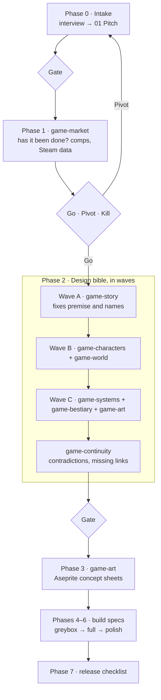

# Claude Game Design Pipeline

A game producer for [Claude Code](https://claude.com/claude-code). It takes a game idea from a pitch to a market check, a full design bible written by eight specialist agents, concept art, and then specs for rough, full and polished builds. You approve every phase at a gate before the next one starts.

```
/game-pm new
/game-pm "Ember Hollow"          # resume a game from its status note
/game-pm backfill "Ember Hollow" # write a bible for a game that already has code
```

## How it works



| Agent | Writes |
|---|---|
| `game-market` | `02 Market Research`: comparable games, market fit, upcoming releases in the niche, a go / pivot / kill verdict with a rubric |
| `game-story` | `03 Story`: logline, structure, beats, endings, hooks and stakes |
| `game-characters` | `04 Characters`: cast table and per-character sheets (want, need, arc, silhouette, voice) |
| `game-world` | `05 World`: regions, factions, world rules, environmental storytelling, authored vs procedural |
| `game-systems` | `06 Gameplay and Systems`: core loop, verbs, combat, items, progression, economy, balance targets, scope cuts |
| `game-bestiary` | `07 Enemies and Bosses`: roles, telegraphs, counters, boss phases |
| `game-art` | `08 Art Direction`, then concept sheets drawn with Aseprite Lua scripts |
| `game-continuity` | A read-only check of all of the above for contradictions and duplicated sources of truth |

## Design choices worth knowing

- **The bible is written in waves, not all at once.** In an early test, parallel agents invented three different names for the same character. Now the story agent fixes the canon first and every later agent adopts it.
- **Every gate is a real decision.** Agents return open decisions with a recommendation; the PM turns them into at most 10 rows you approve, change or reject. Changes re-run only the agents affected.
- **Backfill reads a snapshot, never the working tree.** For an existing game it archives the branch you pick into a temp folder, records the commit in the status note, and treats the code as the truth when the code and notes disagree.
- **The PM doesn't build.** Phases 4 to 6 produce specs with acceptance criteria and hand them to a plan-then-execute flow (the [superpowers](https://github.com/obra/superpowers) skills, if installed). A phase isn't done until the game's test suite passes.
- **Pixel art rules came from review.** `rules.md` carries concrete animation rules (limbs stay attached, guns fire from the barrel tip, no rotating thin pixel art past about 35 degrees) learned from real feedback on generated sprites.

## Install

```bash
git clone https://github.com/Jibbithy/claude-game-design-pipeline
cd claude-game-design-pipeline
./install.sh
export NOTES_VAULT="$HOME/Documents/My Vault"   # where game folders go; defaults to ~/Notes
```

**Requires:** Claude Code and web search. **Optional:** [Godot 4](https://godotengine.org) for the build phases, [Aseprite](https://www.aseprite.org) for concept art, and the `reddit-research` skill from [claude-research-pipeline](https://github.com/Jibbithy/claude-research-pipeline) for community signal in the market check.

**Research library (optional).** `skills/game-pm/research-map.md` lists the game-design reference notes each agent reads first (story structure, combat systems, color theory and so on). They aren't included here. If a note is missing, agents skip it and mark the decision `(judgment)`. The map also explains how to grow your own library as you go.

```bash
bash skills/game-pm/tests/check_structure.sh   # structure test; missing library notes are warnings
```

## License

MIT
