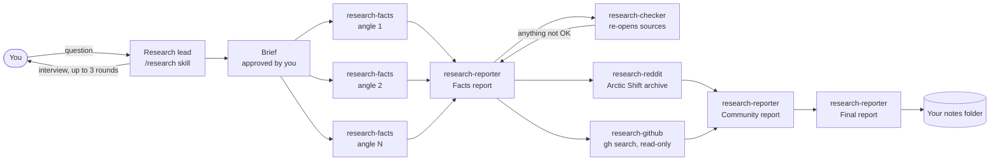

# Claude Research Pipeline

A multi-agent research pipeline for [Claude Code](https://claude.com/claude-code). You ask a question; it interviews you until the question is sharp, sends specialist agents out for sourced facts and for what real people have built and said on GitHub and Reddit, fact-checks the numbers, and writes one report into your notes folder.

```
/research is it worth self-hosting a password manager for a family?
```

## How it works



| Phase | Who | Output |
|---|---|---|
| 1. Find the real question | The lead (only agent that talks to you) | `<Topic> - Brief.md`, the one approval gate |
| 2. Facts and statistics | One `research-facts` per angle, in parallel, then `research-reporter` and `research-checker` | `<Topic> - Facts.md` plus a fact-check table |
| 3. What other people have done | `research-reddit` and `research-github` in parallel, then `research-reporter` | `<Topic> - Community.md` |
| 4. Combine | `research-reporter` | `<Topic> - Report.md`, linked from a Research Hub note |

## Design choices worth knowing

- **Only the lead asks questions.** A subagent that waits on the user deadlocks the whole run, so agents write open questions to disk and return.
- **One gate, then it runs.** You approve the brief; Phases 2 to 4 run back to back.
- **Numbers get checked, not trusted.** `research-checker` re-opens the source behind each key number and checks its scope, date and source type. At most one revise loop, and anything still wrong stays flagged in the report.
- **Files on disk are the truth.** Every agent returns a short `STATUS:` block; its real output is a markdown file. A run can stop and resume from the topic's Status note.
- **GitHub is read-only.** No stars, forks, issues or clones into your projects. Stars are reported alongside last push, license and open issues, and stale repos are flagged.
- **Reddit goes through the Arctic Shift archive.** It is the one path that works without Reddit API keys, and the skill says plainly when a question can't be answered that way instead of guessing from web search.

## Install

```bash
git clone https://github.com/Jibbithy/claude-research-pipeline
cd claude-research-pipeline
./install.sh            # copies skills/ and agents/ into ~/.claude (skips anything that exists)
```

Then set where reports go (defaults to `~/Notes`). An [Obsidian](https://obsidian.md) vault works well because the notes use `[[wikilinks]]`, but any folder is fine:

```bash
export NOTES_VAULT="$HOME/Documents/My Vault"
```

**Requires:** Claude Code, the [GitHub CLI](https://cli.github.com) signed in (`gh auth login`), and web search enabled.

## What's in the repo

```
skills/research/          the lead: SKILL.md, rules, toolbox, note templates, a structure test
skills/reddit-research/   Reddit via the Arctic Shift archive (see THIRD_PARTY_NOTICES.md)
agents/research-*.md      the five specialists
```

Run the structure test against your install:

```bash
bash skills/research/tests/check_structure.sh
```

## License

MIT. `skills/reddit-research` is adapted from Kevin Brazell's MIT-licensed skill; see [THIRD_PARTY_NOTICES.md](THIRD_PARTY_NOTICES.md).
