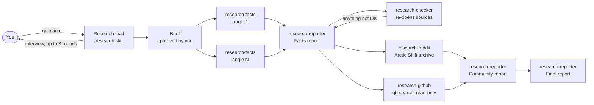
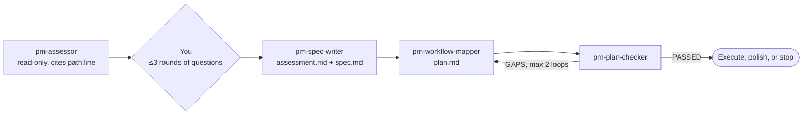

# Claude Code Skills

[](https://github.com/Jibbithy/claude-code-skills/actions/workflows/ci.yml)

Skills and subagents for [Claude Code](https://claude.com/claude-code) that I use every day. Each one is a pipeline, not a prompt: specialist agents, approval gates, files on disk as the source of truth, and a test that checks the structure.

| Skill | What it does | Agents |
|---|---|---|
| [`research`](#research) | Pins down the real question, gathers sourced facts, fact-checks them, adds what people built and said on GitHub and Reddit, writes one report | 5 |
| [`reddit-research`](#research) | Reddit via the Arctic Shift archive, no API keys | — |
| [`product-manager`](#product-manager) | Evidence-cited assessment of any codebase, then a spec and a verifiable phased plan | 4 |
| [`game-pm`](#game-pm) | Game idea → market check → design bible by 8 agents → concept art → build specs | 8 |
| [`website-design`](#website-design) | Websites that don't look AI-made: direction, `DESIGN.md`, every state, scored screenshot review | — |
| [`website-hardening`](#website-hardening) | Security, legal, accessibility, performance, gated pentest, go / no-go report | — |

## Install

```bash
git clone https://github.com/Jibbithy/claude-code-skills
cd claude-code-skills
./install.sh            # copies skills/ and agents/ into ~/.claude, skips anything that exists
export NOTES_VAULT="$HOME/Documents/My Vault"   # where research and game notes go; defaults to ~/Notes
```

Want just one? Copy `skills/<name>` into `~/.claude/skills/` and its agents (same prefix, e.g. `agents/research-*.md`) into `~/.claude/agents/`.

**Requires:** Claude Code. Some skills also want web search, the [GitHub CLI](https://cli.github.com), Node 18+, or Playwright; each section says which.

---

## research

You ask a question; the lead interviews you until it's sharp, sends specialist agents out for sourced facts and for what real people have built and said on GitHub and Reddit, fact-checks the numbers, and writes one report into your notes folder.

```
/research is it worth self-hosting a password manager for a family?
```



- **Only the lead asks questions.** A subagent that waits on the user deadlocks the run, so agents write open questions to disk and return.
- **Numbers get checked, not trusted.** `research-checker` re-opens the source behind each key number and checks scope, date and source type.
- **Files on disk are the truth.** A run can stop and resume from the topic's Status note.
- **GitHub is read-only.** No stars, forks, issues or clones. Stale repos are flagged.
- **Reddit goes through the Arctic Shift archive**, the one path that works without API keys. The skill says plainly when a question can't be answered that way.

Requires web search and `gh auth login`.

## product-manager

Answers "what does this project still need?" on any codebase. It assesses what is actually built, with evidence for every claim, asks only what it can't work out from the code, then writes a spec and a phased plan where every task has a command that proves it's done. A separate agent checks the plan against the spec before you see it.

```
/product-manager                        # assess the current repo
/product-manager ~/code/my-app "add team billing"
```



- **Evidence or it didn't happen.** The assessor is read-only and cites a file and line, or a command and its output, for every claim.
- **Converge mode.** Run it again on a project with a spec and it marks met criteria `[MET]` and puts remaining work in a new dated folder.
- **A checker that can say no.** `pm-plan-checker` returns `PASSED` or numbered blockers; only flagged gaps are redone, at most twice.
- **No PM theater.** RICE scores, OKRs and personas are banned. Output is files, commands, tools and data flow.

## game-pm

Takes a game idea from a pitch to a market check, a full design bible written by eight specialist agents, concept art, and specs for rough, full and polished builds. You approve every phase at a gate.

```
/game-pm new
/game-pm "Ember Hollow"          # resume from its status note
/game-pm backfill "Ember Hollow" # write a bible for a game that already has code
```

| Agent | Writes |
|---|---|
| `game-market` | Comparable games, market fit, upcoming releases, a go / pivot / kill verdict with a rubric |
| `game-story` | Logline, structure, beats, endings, hooks and stakes |
| `game-characters` | Cast table and sheets (want, need, arc, silhouette, voice) |
| `game-world` | Regions, factions, world rules, authored vs procedural |
| `game-systems` | Core loop, combat, items, progression, economy, balance targets, scope cuts |
| `game-bestiary` | Enemy roles, telegraphs, counters, boss phases |
| `game-art` | Art direction, then concept sheets drawn with Aseprite Lua scripts |
| `game-continuity` | Read-only check of all of the above for contradictions |

- **The bible is written in waves.** In an early test, parallel agents invented three names for one character. Now the story agent fixes canon first and later agents adopt it.
- **Backfill reads a snapshot, never the working tree**, and records the commit it read.
- **The PM doesn't build.** Build phases produce specs with acceptance criteria; a phase isn't done until the game's tests pass.

Optional: [Godot 4](https://godotengine.org), [Aseprite](https://www.aseprite.org). `skills/game-pm/research-map.md` lists reference notes agents read first; they aren't included, and missing ones are skipped.

## website-design

For building and redesigning sites, dashboards and web apps that don't look AI-generated. The agent decides what kind of page it's building before choosing a style, writes the design system to `DESIGN.md` before code, builds every state (loading, empty, error), then screenshots its work and scores it.

```
make a landing page for my coffee roaster
redesign this dashboard, it looks generic
```

- **Precedence:** your words, then the project's existing design system, then the skill's taste.
- **States before pages:** twelve designable states plus 0 / 1 / many / overlong fixtures.
- **Verify:** `scripts/shoot.sh` screenshots with Playwright; the result must score **80/100** on a ten-check rubric, with at most three fix-and-rescore passes.
- **References:** type, color and spacing numbers measured from shipped design systems, and a list of 45 "AI tells" with when each is actually fine.

For screenshots: Node and Playwright (`npx playwright install chromium`).

## website-hardening

Takes a site from "it works" to "safe to launch": security, privacy and legal basics, accessibility, performance, code cleanup, and authorized pentesting of a site you own. Ends with one go / no-go report.

```bash
node skills/website-hardening/tests/make-fixture.mjs      # build the seeded vulnerable site
node skills/website-hardening/scripts/scan.mjs --self-test
# self-test: 38 seeded defects, 38 distinct checks fired, 60 findings total.
```

- **A real scanner with a test that proves it works.** `scan.mjs` is dependency-free and never sends a request.
- **The safety gate is in code.** `swarm.mjs` refuses to probe without `--owned-confirmed`, refuses non-local targets without `--prod-approved`, and lists what it did *not* try.
- **A conservative verdict.** LAUNCH-READY only when no Blocker or High is open *and* runtime checks (axe, Lighthouse, manual items) are confirmed.

Requires Node 18+. Optional: Playwright, axe, Lighthouse, `gitleaks`.

> Only test sites you own or have written permission to test.

---

## Tests

CI runs on every push: shell lint, frontmatter checks on every skill and agent, the research and game-pm structure tests, and the website-hardening scanner self-test.

```bash
bash tests/check_frontmatter.sh
SK=skills/research AG=agents bash skills/research/tests/check_structure.sh
```

## License

MIT. Some files are adapted from other MIT-licensed projects; see [THIRD_PARTY_NOTICES.md](THIRD_PARTY_NOTICES.md).
