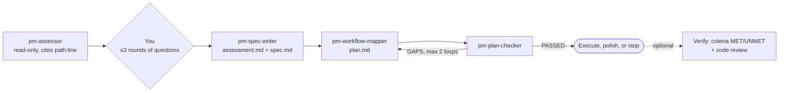

# Claude Product Manager

A product-manager skill for [Claude Code](https://claude.com/claude-code) that answers "what does this project still need?" on any codebase. It assesses what is actually built, with evidence for every claim, asks you only what it can't work out from the code, then writes a spec and a phased plan. Each task in the plan comes with a command that proves it's done. A separate agent checks the plan against the spec before you see it.

```
/product-manager                        # assess the current repo
/product-manager ~/code/my-app "add team billing"
```

## How it works



Everything lands in the target project at `docs/pm/YYYY-MM-DD-<slug>/`:

| File | What it is |
|---|---|
| `assessment.md` | Current state. Every claim cites a `path:line` or a command and its output |
| `spec.md` | Current → target → gap, with acceptance criteria you can check, and non-goals |
| `plan.md` | A workflow map (step → tool → artifact → who uses it), then phased tasks with exact files and a verify command each |
| `verification.md` | Optional, after the build: each criterion marked MET or UNMET with evidence |

## Design choices worth knowing

- **Evidence or it didn't happen.** The assessor is read-only and has to cite a file and line, or a command and its output, for every claim about the current state.
- **Converge mode.** Run it again on a project that already has a spec and it updates instead of restarting: met criteria are marked `[MET]`, and the remaining work goes into a new dated folder. Old artifacts are never edited.
- **A checker that can say no.** `pm-plan-checker` works backward from the spec and returns `PASSED` or a numbered list of blockers. Fixes are targeted: only the flagged gaps are re-done, at most twice, and anything left is reported, not hidden.
- **No PM theater.** RICE scores, OKRs, personas and roadmap filler are banned in every prompt. Output is files, commands, tools and data flow.
- **Nothing expensive runs on a guess.** Web or Reddit research, execution and verification all ask first.

## Install

```bash
git clone https://github.com/Jibbithy/claude-product-manager
cd claude-product-manager
./install.sh
```

**Requires:** Claude Code. **Optional:** the [superpowers](https://github.com/obra/superpowers) plugin to execute plans, and the `reddit-research` skill from [claude-research-pipeline](https://github.com/Jibbithy/claude-research-pipeline) for community research during the spec phase.

## License

MIT
